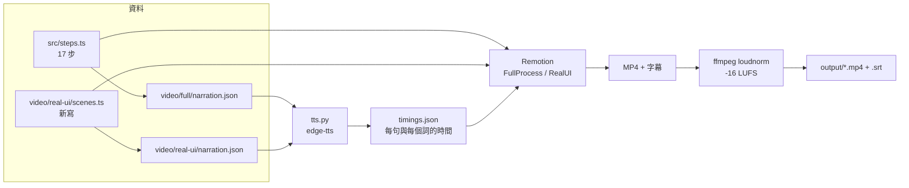
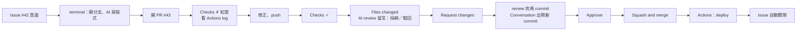

# Handoff：影片製作（給做動畫的 session）

> 交接日期：2026-11-25。接手後先讀這份文件和 `RESUME.md`，開工前用 AskUserQuestion 把「待確認」那一節的問題問完。
> 回覆一律用繁體中文；說明用中文，PR、CI、commit、diff 等術語保留英文。

## 1. 要做什麼

| | 片一：完整流程動畫 | 片二：真實介面操作 |
|---|---|---|
| 目的 | 看懂整條流程，以及人、AI、GitHub、CI/CD 怎麼交棒 | 看懂在 GitHub 上實際要按哪裡、看哪裡 |
| 長度 | 5–7 分鐘 | 8–10 分鐘（要留時間看清楚每個按鈕） |
| 畫面 | 沿用網頁的「泳道＋模擬畫面」風格，做成動畫 | 用 Remotion **重建高擬真**的 GitHub／terminal 介面（使用者已選定，不錄真實畫面） |
| 內容來源 | `src/steps.ts` 的 17 步（直接共用） | 新寫的場景資料（見 §4） |
| 案例 | 待辦 App 的「到期日提醒」、Issue #42、PR #43 | 建議沿用同一個案例（待確認） |
| 旁白 | TTS 中文配音＋字幕 | 同左 |

兩支片共用的決策（2026-11-25 grilling 定案，詳見 memory `project-scope-decisions`）：
- 觀眾是使用者自己（學習用）。
- AI 協作只有兩個環節：AI 寫程式、AI 先 review PR。
- 驗證 AI 產出共四道關卡：人先看 diff、用測試當裁判、AI 的說法要附依據、AI review 也要經過驗證。
- 只演兩個失敗迴圈：CI 失敗 → 修正重推；Review 要求修改 → 再 commit。部署失敗和 rollback 不演。

## 2. 製作流程

片二重建的操作順序（建議，待確認）：

## 3. 現況（已核對原始碼）

| 項目 | 現況 | 依據 |
|---|---|---|
| repo | 公開，https://github.com/yiyiscode/dev-process-animation | — |
| 分支 | `feat/web-app`；PR #1 尚未 merge（2026-11-25 查詢時為 OPEN） | `gh pr view 1` |
| 流程資料型別 | `Step`：stage、actor、title、short、desc、loop?、gate?、screen | `src/steps.ts:8` |
| 角色與顏色 | 4 個角色，顏色使用 CSS 變數 | `src/steps.ts:21`、`src/index.css:2-3` |
| 步驟數 | 17 步（2 步 `loop`、3 步 `gate`，涵蓋關卡 1–4） | `src/steps.ts:29-81` |
| 網頁元件 | `Lanes`、`Screen`、`Card` 都**沒有 export**，只在 `App.tsx` 內部使用；影片要共用的話，得先搬到 `src/components/` | `src/App.tsx:7,48,57` |
| 泳道尺寸 | `COL_W=56`、`LANE_H=56`、`LABEL_W=150`，SVG 以 1:1 px 顯示 | `src/App.tsx:5` |
| 字級規則 | 最小 14px，只掃 `src/`；`video/` 不在掃描範圍 | `tests/font-size.test.ts:6,10` |
| 型別檢查 | `tsc -b` 只檢查 `src/`（`tsconfig.app.json` 的 include），`video/` 要另外設定 | `tsconfig.app.json` |
| Pages 子路徑 | `base: '/dev-process-animation/'` | `vite.config.ts:7` |
| npm scripts | dev、build、lint（oxlint）、test（node --test）、shots | `package.json:7-12` |
| Remotion | **尚未安裝** | `package.json`（沒有 remotion） |
| PR 截圖 | `npm run shots -- <PR>`，用本機 Chrome（`channel: 'chrome'`），截圖存到 `docs/pr-screenshots/<PR>/` | `scripts/shots.ts:9,23` |

## 4. TTS 和音訊：沿用 Time Series Analysis 專案

來源：`D:\Learning\Time Series Analysis\src\tts.py`（建議複製到 `video/tts.py`）

| 項目 | 值 | 依據（Time Series 專案） |
|---|---|---|
| 聲音 | `zh-TW-YunJheNeural`，語速 `+10%`（使用者試聽後選定） | `src/tts.py:15-16`、`RESUME.md:37` |
| 開頭留白 | 0.6 秒 | `src/tts.py:17` |
| 旁白 JSON 格式 | `{video, dir?, gap_after, sentences:[{id, text, gap_after?}]}` | `src/tts.py:48-50,58,71`、`script/video1_narration.json` |
| 輸出 | `<dir>/audio/<video>/<id>.mp3`，以及 `<dir>/build/<video>/timings.json`（每句的 start/end/dur 和逐詞時間 words） | `src/tts.py:51-52,72-81` |
| 快取 | 文字、聲音、語速都沒變就沿用舊 mp3 | `src/tts.py:60-69` |
| 重試 | edge-tts 偶爾不回音訊，退避後重試 6 次 | `src/tts.py:20-28`、`RESUME.md:34` |
| 執行環境 | conda `make_video`（python 3.11、ffmpeg、edge-tts） | `RESUME.md:6` |
| 音量 | `loudnorm=I=-16:TP=-1.5:LRA=11` | `src/build_video.py:198` |

注意：
- `tts.py` 用 `ROOT = parents[1]` 算路徑（`src/tts.py:14`），搬到 `video/tts.py` 後 ROOT 會變成 repo 根目錄，`dir` 欄位要寫成相對 repo 根目錄的路徑。
- Time Series 專案用 Manim，畫面和旁白的對齊靠 `SyncScene.W(sid, phrase)` 找出某個詞的時間點（`src/common.py:85`）。換成 Remotion 後要寫一個對應的 helper：從 timings.json 的 words 查出時間，再乘以 fps 換成影格。
- 時間要對齊到整數影格，否則會漂移（Time Series 原本在 7 分鐘內漂移了 1.9 秒，`RESUME.md:14`）。
- 字型要有中文字形：Consolas 沒有中文，曾經出現豆腐字（`RESUME.md:13`）。程式碼畫面裡出現中文時，要指定有中文的 fallback 字型。
- 字幕：Time Series 用 ffmpeg drawtext 燒錄字幕，因為 conda 的 ffmpeg 沒有 libass（`RESUME.md:39`）。改用 Remotion 後，可以直接在畫面上渲染字幕，再由 timings.json 輸出 .srt，就不需要 drawtext。

## 5. 建議做法（接手後先確認）

1. 先把 `Lanes`、`Screen`、`Card` 搬到 `src/components/` 並 export，網頁行為不變（`npm test` 和 `npm run shots` 都要過）。
2. 安裝 Remotion，放在 `video/`，建兩個 composition：`FullProcess`、`RealUI`，1920×1080、30fps。
3. 片一：用 `STEPS` 產生旁白草稿 → 使用者確認文字 → 跑 TTS → Remotion 依 timings 排程。
4. 片二：先寫腳本（場景、要按的按鈕、旁白），使用者確認後再刻 GitHub 介面元件（Issue、PR Conversation、Files changed、Checks、Actions log、Merge 按鈕）。
5. 每支片先出 480p 預覽給使用者看，再渲染 1080p。

## 6. 待確認（開工前問使用者）

- 片二是否沿用 Issue #42／PR #43 的案例，讓兩支片可以互相對照？
- 片二是否也要演 AI 寫程式與 AI review（在 terminal 裡重建 Claude Code 的畫面）？
- 要不要加角色？Time Series 的活潑版用 Clawd 當主講（`RESUME.md:17-19`）。
- 背景音樂：要不要加？用哪一首 CC0 音樂？
- 影片字級：1080p 畫面的最小字級要不要也寫成測試？
- Remotion 授權：開工前到 remotion.dev 確認個人使用的授權條件。

## 7. 規則（沿用使用者的全域設定）

- 新的介面或畫面風格，要先在 `design-demos/<日期>-<主題>.html` 做 2–3 個方案給使用者選。
- 每個里程碑都 commit 到功能分支；動 `main` 之前先問。同步更新 `RESUME.md`。
- PR 一律附上操作截圖（memory `feedback-pr-screenshots`）。
- 網頁字級最小 14px，測試會把關（memory `project-font-size-rule`）。
- Windows 環境：Python 要設 `PYTHONIOENCODING=utf-8`；多行 commit 訊息先寫成檔案，再用 `git commit -F`。
